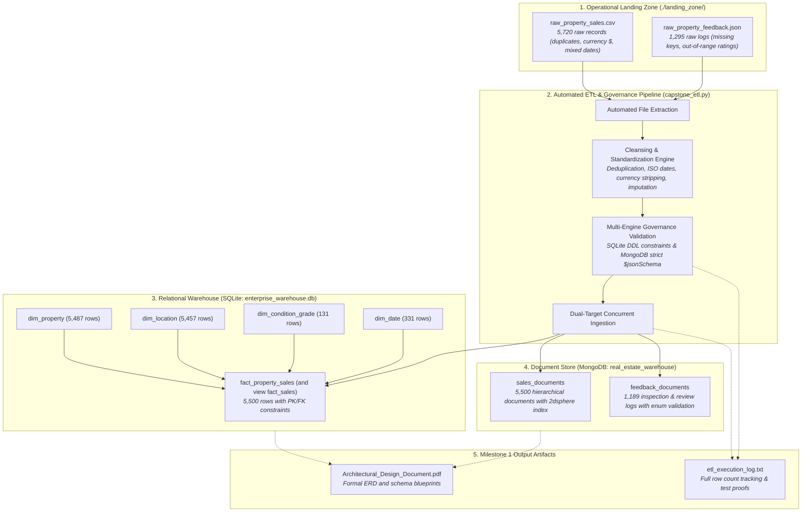
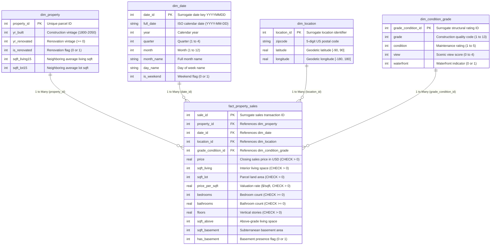

# Enterprise Multi-Engine Data Warehouse & BI System
## Milestone 1: Architectural Design Document & ERD Blueprint
**Course:** Data Warehousing (LEC/LAB) — Lesson 8 Final Project  
**Domain:** Real Estate Property Listing & Regional Market Value Warehouse (Group 10)  
**Instructor:** Prof. Rob Malitao  
**Date:** October 26, 2026  
**Deliverable Status:** Milestone 1 Complete (Due: October 26, 2026)  

---

## 1. Executive Summary & Warehouse Architecture

To resolve enterprise reporting latency and provide deep-dive historical valuation analytics without degrading live operational databases, this project deploys a centralized, high-performance **Multi-Engine Data Warehouse Architecture**. The system pairs a structured, normalized relational **Star Schema (SQLite)** with a flexible, semi-structured **Document Store (MongoDB)**.



---

## 2. Visual Entity-Relationship Diagram (ERD)

The relational warehouse is architected in a classic dimensional **Star Schema** ensuring that dimension tables are normalized to eliminate operational update anomalies while the central fact table stores core transactional metrics at the individual property closing level.



---

## 3. Relational Star Schema Data Dictionary (SQLite: `enterprise_warehouse.db`)

### Table: `fact_property_sales` (and view `fact_sales`)
*The central fact table storing individual real estate sale transactions with foreign keys linking to all dimension tables.*

| Column Name | Data Type | Key Type | Nullable | Constraints & Bounds | Business Definition |
| :--- | :--- | :--- | :--- | :--- | :--- |
| `sale_id` | INTEGER | PK | No | AUTOINCREMENT | Unique surrogate sales transaction identifier. |
| `property_id` | INTEGER | FK | No | REFERENCES `dim_property(property_id)` | Foreign key linking to the physical parcel dwelling asset. |
| `date_id` | INTEGER | FK | No | REFERENCES `dim_date(date_id)` | Foreign key linking to the transaction closing calendar date. |
| `location_id` | INTEGER | FK | No | REFERENCES `dim_location(location_id)` | Foreign key linking to the geographic postal centroid. |
| `grade_condition_id`| INTEGER | FK | No | REFERENCES `dim_condition_grade` | Foreign key linking to the structural assessment rating. |
| `price` | REAL | Measure | No | `CHECK (price > 0.0)` | Total closing transaction sales price in USD ($). |
| `sqft_living` | INTEGER | Measure | No | `CHECK (sqft_living > 0)` | Finished interior living area in square feet. |
| `sqft_lot` | INTEGER | Measure | No | `CHECK (sqft_lot > 0)` | Total land lot parcel footprint in square feet. |
| `price_per_sqft` | REAL | Measure | No | `CHECK (price_per_sqft > 0.0)` | Derived unit valuation metric: `price / sqft_living`. |
| `bedrooms` | INTEGER | Attribute| No | `CHECK (bedrooms >= 0)` | Total count of dedicated bedrooms. |
| `bathrooms` | REAL | Attribute| No | `CHECK (bathrooms >= 0.0)` | Total bathrooms (quarter/half fractional increments allowed).|
| `floors` | REAL | Attribute| No | `CHECK (floors > 0.0)` | Total vertical finished dwelling stories. |
| `sqft_above` | INTEGER | Measure | No | `CHECK (sqft_above >= 0)` | Interior living space located strictly above grade level. |
| `sqft_basement`| INTEGER | Measure | No | `CHECK (sqft_basement >= 0)` | Subterranean basement finished/unfinished area in sqft. |
| `has_basement` | INTEGER | Attribute| No | `CHECK (has_basement IN (0, 1))` | Binary indicator: 1 if `sqft_basement > 0`, else 0. |

---

### Dimension Tables

#### Table: `dim_property`
| Column Name | Data Type | Key Type | Nullable | Constraints & Bounds | Business Definition |
| :--- | :--- | :--- | :--- | :--- | :--- |
| `property_id` | INTEGER | PK | No | `PRIMARY KEY` | Public King County parcel identification number. |
| `yr_built` | INTEGER | Attribute | No | `CHECK (yr_built BETWEEN 1800 AND 2050)` | Year of original construction. |
| `yr_renovated` | INTEGER | Attribute | No | `CHECK (yr_renovated >= 0)` | Year of most recent major structural restoration (0 if never).|
| `is_renovated` | INTEGER | Attribute | No | `CHECK (is_renovated IN (0, 1))` | Binary flag: 1 if `yr_renovated > 0`, else 0. |
| `sqft_living15`| INTEGER | Attribute | No | `CHECK (sqft_living15 > 0)` | Average interior living space of 15 closest neighboring homes. |
| `sqft_lot15` | INTEGER | Attribute | No | `CHECK (sqft_lot15 > 0)` | Average parcel lot area of 15 closest neighboring homes. |

#### Table: `dim_location`
| Column Name | Data Type | Key Type | Nullable | Constraints & Bounds | Business Definition |
| :--- | :--- | :--- | :--- | :--- | :--- |
| `location_id` | INTEGER | PK | No | AUTOINCREMENT | Unique surrogate location identifier. |
| `zipcode` | TEXT | Attribute | No | 5-digit postal code | Standard United States postal ZIP code. |
| `latitude` | REAL | Attribute | No | `CHECK (latitude BETWEEN -90.0 AND 90.0)` | Geodetic latitude coordinate in decimal degrees. |
| `longitude` | REAL | Attribute | No | `CHECK (longitude BETWEEN -180.0 AND 180.0)`| Geodetic longitude coordinate in decimal degrees. |

#### Table: `dim_condition_grade`
| Column Name | Data Type | Key Type | Nullable | Constraints & Bounds | Business Definition |
| :--- | :--- | :--- | :--- | :--- | :--- |
| `grade_condition_id`| INTEGER | PK | No | AUTOINCREMENT | Unique surrogate rating identifier. |
| `grade` | INTEGER | Attribute | No | `CHECK (grade BETWEEN 1 AND 13)` | Official building construction quality code (1=Low, 13=Mansion).|
| `condition` | INTEGER | Attribute | No | `CHECK (condition BETWEEN 1 AND 5)` | Physical maintenance condition rating (1=Poor, 5=Excellent). |
| `view` | INTEGER | Attribute | No | `CHECK (view BETWEEN 0 AND 4)` | Visual scenic vista score (0=None, 4=Panoramic). |
| `waterfront` | INTEGER | Attribute | No | `CHECK (waterfront IN (0, 1))` | Binary indicator: 1 if parcel fronts a body of water, else 0. |

#### Table: `dim_date`
| Column Name | Data Type | Key Type | Nullable | Constraints & Bounds | Business Definition |
| :--- | :--- | :--- | :--- | :--- | :--- |
| `date_id` | INTEGER | PK | No | `PRIMARY KEY` (YYYYMMDD) | Surrogate integer calendar key. |
| `full_date` | TEXT | Attribute | No | Normalized ISO date | ISO-8601 calendar date (`YYYY-MM-DD`). |
| `year` | INTEGER | Attribute | No | Calendar Year | Four-digit calendar transaction year. |
| `quarter` | INTEGER | Attribute | No | `CHECK (quarter BETWEEN 1 AND 4)` | Fiscal/calendar quarter index (1 to 4). |
| `month` | INTEGER | Attribute | No | `CHECK (month BETWEEN 1 AND 12)` | Numerical calendar month (1 to 12). |
| `month_name` | TEXT | Attribute | No | Month Name | Full English month name (e.g., 'May'). |
| `day_name` | TEXT | Attribute | No | Day Name | Full English day name (e.g., 'Friday'). |
| `is_weekend` | INTEGER | Attribute | No | `CHECK (is_weekend IN (0, 1))` | Binary flag: 1 if Saturday/Sunday, else 0. |

---

## 4. Semi-Structured MongoDB Document Store Architecture (`real_estate_warehouse`)

MongoDB is utilized to hold rich, hierarchical architectural records and semi-structured qualitative feedback. Strict governance is configured using `$jsonSchema` with `validationLevel="strict"` and `validationAction="error"`.

### Collection: `sales_documents`
*Hierarchical document capturing property architectural details, location GeoJSON coordinates, and valuation metrics.*

```json
{
  "$jsonSchema": {
    "bsonType": "object",
    "required": ["property_id", "sale_date", "price", "sqft_living", "architectural_specs", "location"],
    "properties": {
      "property_id": {
        "bsonType": ["int", "long"],
        "description": "Unique parcel identifier (integer) and is required"
      },
      "sale_date": {
        "bsonType": "string",
        "pattern": "^\\d{4}-\\d{2}-\\d{2}$",
        "description": "ISO-8601 calendar date string (YYYY-MM-DD)"
      },
      "price": {
        "bsonType": ["double", "int", "long"],
        "minimum": 1.0,
        "description": "Property closing price must be strictly positive"
      },
      "sqft_living": {
        "bsonType": ["int", "long"],
        "minimum": 1,
        "description": "Interior living space must be a positive integer"
      },
      "price_per_sqft": {
        "bsonType": ["double", "int"],
        "minimum": 0.01,
        "description": "Derived unit price per square foot"
      },
      "architectural_specs": {
        "bsonType": "object",
        "required": ["bedrooms", "bathrooms", "floors", "grade", "condition"],
        "properties": {
          "bedrooms": {"bsonType": "int", "minimum": 0},
          "bathrooms": {"bsonType": ["double", "int"], "minimum": 0.0},
          "floors": {"bsonType": ["double", "int"], "minimum": 0.5},
          "grade": {"bsonType": "int", "minimum": 1, "maximum": 13},
          "condition": {"bsonType": "int", "minimum": 1, "maximum": 5},
          "view": {"bsonType": "int", "minimum": 0, "maximum": 4},
          "waterfront": {"bsonType": "int", "enum": [0, 1]},
          "yr_built": {"bsonType": "int", "minimum": 1800, "maximum": 2050}
        }
      },
      "location": {
        "bsonType": "object",
        "required": ["zipcode", "coordinates"],
        "properties": {
          "zipcode": {"bsonType": "string", "pattern": "^\\d{5}$"},
          "coordinates": {
            "bsonType": "array",
            "minItems": 2,
            "maxItems": 2,
            "items": {"bsonType": "double"}
          }
        }
      }
    }
  }
}
```

### Collection: `feedback_documents`
*Captures qualitative stakeholder feedback, licensed inspection results, and NLP sentiment scores.*

```json
{
  "$jsonSchema": {
    "bsonType": "object",
    "required": ["review_id", "property_id", "review_date", "rating", "reviewer_category", "inspection_passed"],
    "properties": {
      "review_id": {
        "bsonType": "string",
        "description": "Unique string review identifier"
      },
      "property_id": {
        "bsonType": ["int", "long"],
        "description": "Target property integer identifier"
      },
      "review_date": {
        "bsonType": "string",
        "pattern": "^\\d{4}-\\d{2}-\\d{2}$",
        "description": "ISO-8601 review date string (YYYY-MM-DD)"
      },
      "rating": {
        "bsonType": ["int", "long"],
        "minimum": 1,
        "maximum": 5,
        "description": "Property inspection score rating (1 to 5 scale)"
      },
      "reviewer_category": {
        "bsonType": "string",
        "enum": ["Buyer", "Seller", "Licensed Inspector", "Certified Appraiser", "Tenant"],
        "description": "Restricted stakeholder classification"
      },
      "inspection_passed": {
        "bsonType": "bool",
        "description": "Boolean flag indicating whether official inspection passed"
      },
      "sentiment_score": {
        "bsonType": ["double", "int"],
        "description": "NLP sentiment polarity score (-1.0 to +1.0)"
      },
      "comments": {
        "bsonType": "string",
        "description": "Narrative qualitative review comments"
      },
      "architectural_highlights": {
        "bsonType": "array",
        "items": {"bsonType": "string"}
      }
    }
  }
}
```

---

## 5. Automated Multi-Target ETL Pipeline Flow & Execution Audit

The pipeline script [capstone_etl.py](file:///c:/CJ/Visual%20Studio/DataWarehousing/Data-Warehousing-midterm-mini-project/milestone%201/capstone_etl.py) extracts operational files from `./landing_zone/`, applies standardized cleansing, enforces relational and document governance, and logs an exhaustive execution audit in [etl_execution_log.txt](file:///c:/CJ/Visual%20Studio/DataWarehousing/Data-Warehousing-midterm-mini-project/milestone%201/etl_execution_log.txt).

### Audit Summary Metrics:
* **Raw Operational Extraction:**
  * Raw Sales Rows Ingested: **5,720 rows**
  * Raw Feedback Documents Read: **1,295 documents**
* **Cleansing & Hygiene Actions:**
  * Exact Duplicate Rows Dropped: **150 rows**
  * Missing / Corrupted Key Rows Dropped: **9 rows**
  * Unparseable Date Rows Dropped: **5 rows**
  * Business Rule / Constraint Violators Dropped: **40 rows**
  * Same-Day Duplicate Txns Dropped: **16 rows**
  * Duplicate Feedback IDs Dropped: **65 documents**
  * Missing Feedback Keys Dropped: **30 documents**
  * Out-of-Bounds Ratings Dropped: **11 documents**
* **Dual-Target Ingestion Counts:**
  * Clean Relational Fact (`fact_property_sales`): **5,500 rows**
  * Dimension Properties (`dim_property`): **5,487 rows**
  * Dimension Locations (`dim_location`): **5,457 rows**
  * Dimension Condition/Grades (`dim_condition_grade`): **131 rows**
  * Dimension Dates (`dim_date`): **331 rows**
  * Clean MongoDB Sales (`sales_documents`): **5,500 documents**
  * Clean MongoDB Feedback (`feedback_documents`): **1,189 documents**
* **Governance Verification Suite (Unit Tests):**
  * SQLite Negative Price CHECK: `[PASSED]` (*blocked by CHECK constraint*)
  * SQLite Foreign Key Referential Integrity: `[PASSED]` (*blocked by FOREIGN KEY constraint*)
  * MongoDB $jsonSchema Rating Bounds (Rating: 7): `[PASSED]` (*blocked by Document Validation*)
  * MongoDB $jsonSchema Negative Price (-100.0): `[PASSED]` (*blocked by Document Validation*)

**Pipeline Execution Time:** **0.98 seconds** | **Audit Status:** **100% PASS**
